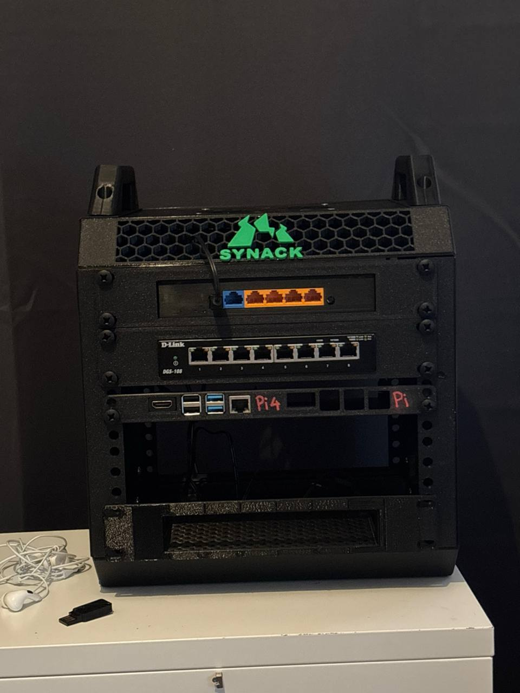
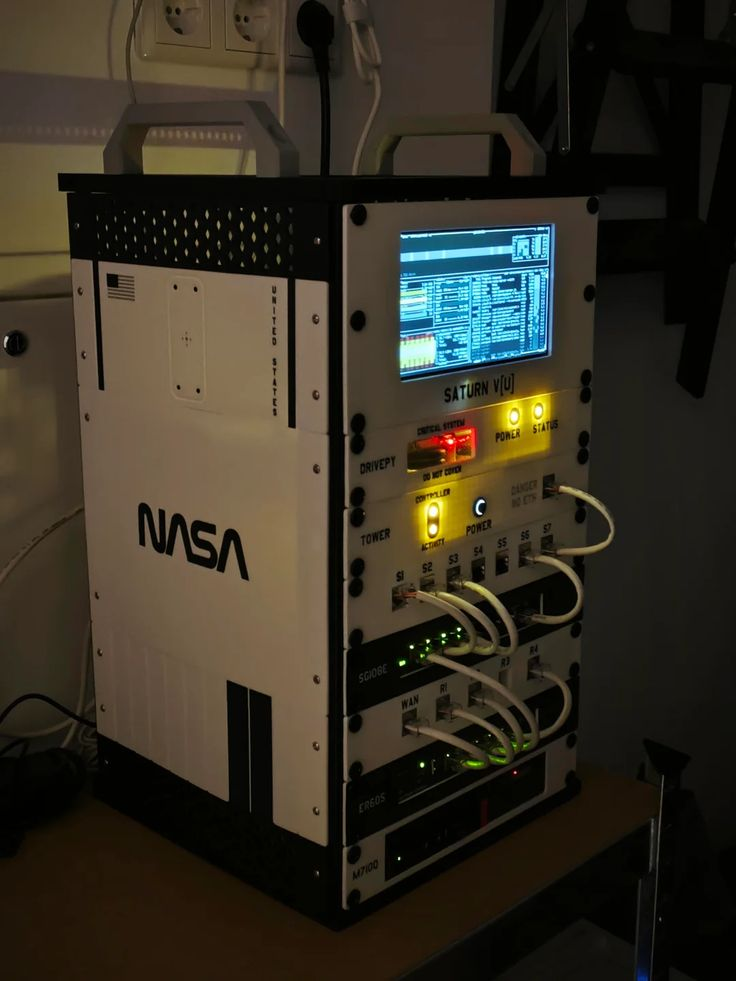
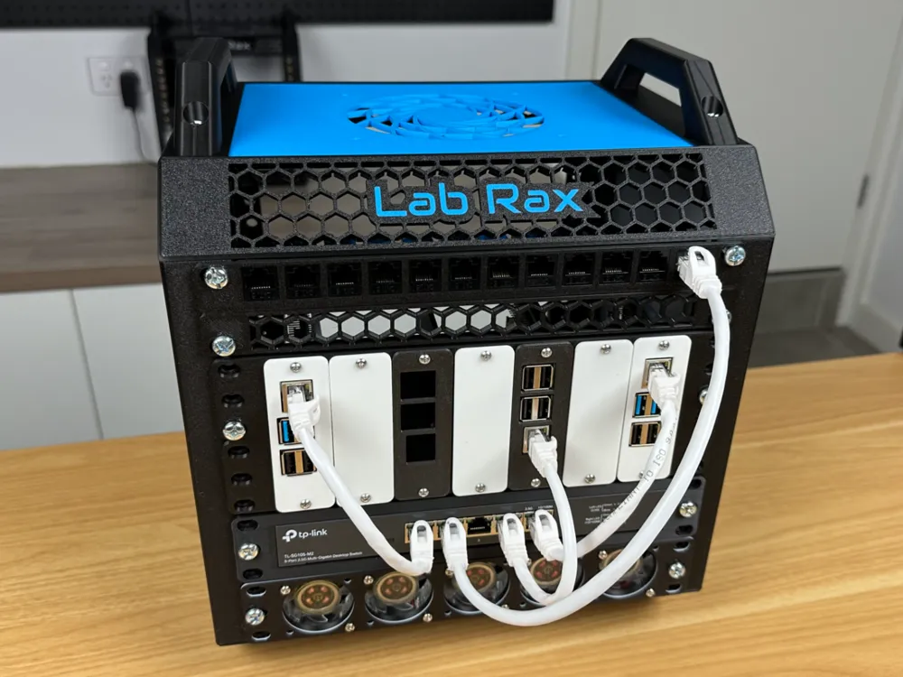
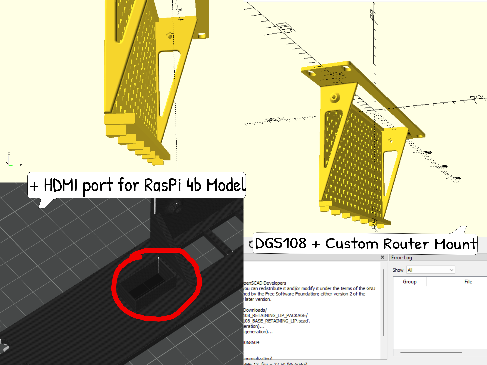
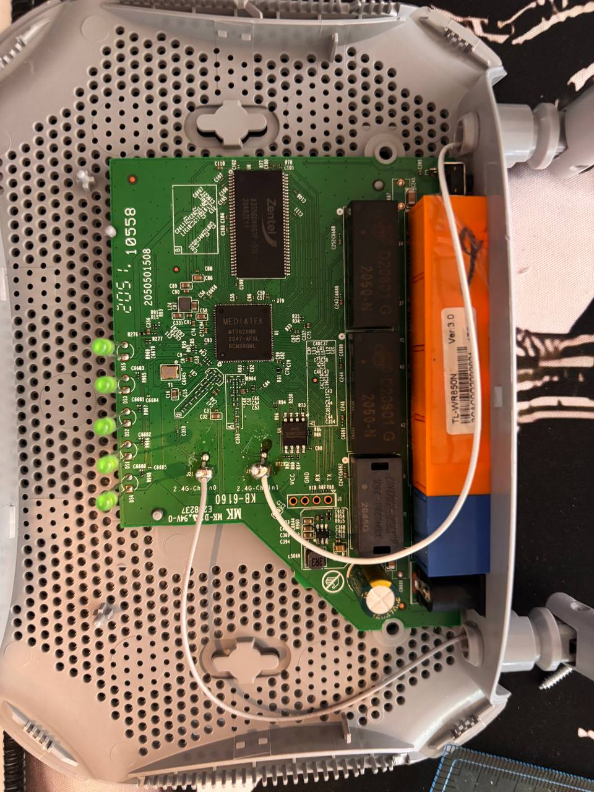
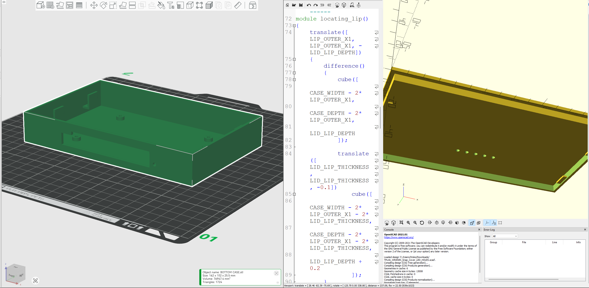
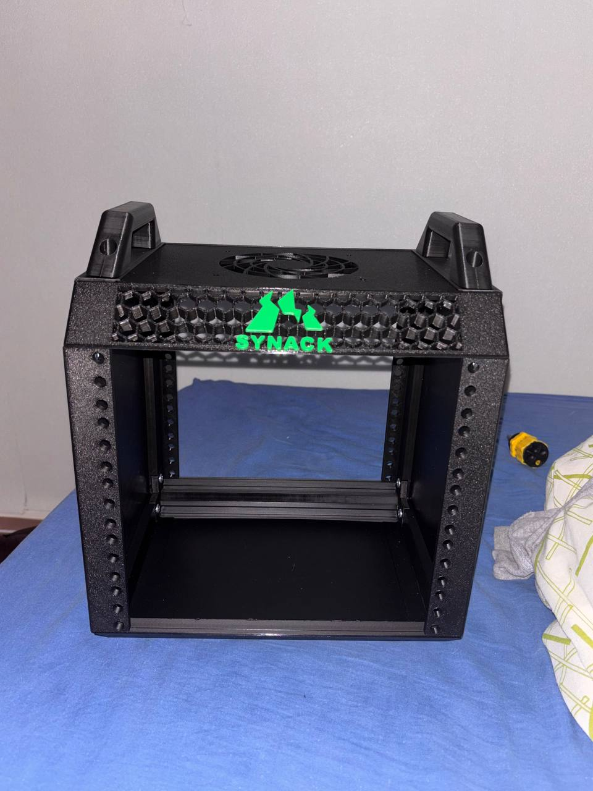

# SYNACK Home Lab

A compact, 3D-printed networking and cybersecurity lab built around a custom rack layout. This project combines open-source 3D models, my own CAD work, hardware modification and network engineering to create a practical environment for security experiments and student events.

## Final Build



The current setup brings together a TP-Link N300 router, a D-Link DGS-108 8-port Gigabit switch and a Raspberry Pi 4 in a compact rack based on the open-source Labrax design. The rack is intended to support controlled networking exercises, cybersecurity experiments and practical CTF demonstrations.

## Hardware

| Component | Purpose |
| --- | --- |
| Labrax rack | Open-source rack structure, adapted for my layout |
| TP-Link N300 router | Local routing and lab network |
| D-Link DGS-108 | 8-port Gigabit Ethernet switching |
| Raspberry Pi 4 | Lightweight services and network utilities |
| Mini PC | Planned main host for virtual machines, lab services and CTF infrastructure |

## Build Process

I wanted the rack to be more than a collection of devices placed on shelves. I started from existing open-source designs, modified the layout and mounts to suit my hardware, and designed a custom router enclosure so the equipment would fit together cleanly.

### 1. Reference Design and Planning



I used the open-source Labrax rack as the starting point and reviewed the available device mounts before adapting the design to suit my equipment. The goal was to keep the setup compact while preserving access to ports, screws and cabling.

### 2. Original Rack Model




### 3. Rack and Mount Improvements




I adapted the existing mounts to better suit my devices. Changes included adding a rear retaining lip to help hold the router and DGS-108 in place, and modifying the Raspberry Pi mount with an HDMI opening and retaining lip. These changes improved the fit and made the required ports more accessible.

### 4. Router Disassembly




The original TP-Link N300 housing did not suit the rack layout, so I disassembled the router to measure and accommodate the internal board and external connections. The modification included desoldering the antennas from the original housing. This was a delicate step, requiring care around the PCB, antenna connections and clearances.

### 5. Custom Router Enclosure Design




I designed a new enclosure for the TP-Link N300, aiming for a form factor that matched the DGS-108 and sat neatly in the rack. I accounted for port alignment, board clearance, mounting points and access to the router's controls and connectors.

### 6. 3D Printing with the Bambu Lab P1S

I printed the rack components and custom parts using a **Bambu Lab P1S**. I used **PLA** for this version because the devices are relatively low-power and the lab is not intended to run high-heat hardware. Temperature and airflow still need to be checked during extended operation. For future revisions, I plan to use **PETG** where greater toughness and heat resistance would be useful.

Fit checks were an important part of the process. Port openings, screw access, mounting tolerances and cable clearance all needed to line up with the physical hardware.

### 7. Printed and Assembled Router



[Printed and assembled router enclosure](docs/images/07-assembled-router/assembled-router-enclosure2.png)

After printing, I fitted the router hardware into the enclosure and checked the alignment of the ports and mounting points. The finished enclosure gives the router a consistent form factor with the other rack-mounted equipment.

### 8. Final Rack Assembly


The final assembly brings the router, switch and Raspberry Pi into one compact platform. The custom SYNACK logo ties the parts together visually, while the revised mounts help keep the devices aligned and secure.

### 9. Network Topology


## Networking and Cybersecurity Use

The lab provides a controlled environment for:

- Practising IP addressing, subnetting, switching, routing and network troubleshooting.
- Using Nmap to discover devices and enumerate exposed services.
- Using Wireshark to inspect traffic and investigate network behaviour.
- Testing firewall rules, access controls and network separation.
- Running virtual machines and repeatable CTF challenges on a mini PC once installed.
- Demonstrating reconnaissance, enumeration, vulnerability identification and defensive remediation during student events.
- Experimenting with lightweight monitoring and utility services on the Raspberry Pi.

This project complements my CCNA learning and Cyber Security degree by letting me test configurations on physical devices, record results and troubleshoot issues outside a simulated environment. The longer-term aim is to use the lab for personal experiments and controlled CTF or hackathon activities within **BCUCompSoc**, with a repeatable setup that can be administered and reset between sessions.

All security testing is intended for systems in this lab or other environments where I have explicit permission.

## Materials and Design Decisions

- **Printing hardware:** Bambu Lab P1S.
- **Material used:** PLA for the current build.
- **Future material:** PETG for revisions where additional toughness or heat resistance is beneficial.
- **Design approach:** Reuse open-source models where suitable, then document and publish my own enclosure and mount adaptations separately.
- **Practical challenges:** Achieving a consistent rack-mounted form factor, keeping ports accessible, providing enough clearance for cables and fasteners, and modifying the router housing without damaging the board or antenna connections.

## Repository Structure

```text
.
├── docs/
│   └── images/
│       ├── 01-concept-and-inspiration/
│       ├── 02-original-rack/
│       ├── 03-rack-modifications/
│       ├── 04-router-disassembly/
│       ├── 05-router-enclosure-design/
│       ├── 06-printing-bambu-lab-p1s/
│       ├── 07-assembled-router/
│       ├── 08-final-rack/
│       └── 09-network-topology/
├── models/
│   ├── open-source/
│   │   ├── labrax-rack/
│   │   └── device-mounts/
│   └── custom/
│       ├── router-enclosure/
│       ├── modified-device-mounts/
│       └── synack-logo/
└── network/
```

STL files are suitable for printing.

## Open-Source Credits

The Labrax rack and reused device mounts are based on third-party designs. Before publishing those files, add the original author, source URL and licence. Label modified files clearly and follow the original licence terms.

- **Labrax rack:** [Makerworld - LabRax](https://makerworld.com/en/collections/5813742-lab-rax)
- **Original device mounts:** [MakerWorld - Pi4](https://makerworld.com/en/models/2156118-raspberry-pi-4-10-rack-mount-series?from=search#profileId-2337263) & [Printables - DGS108](https://www.printables.com/model/1694721-d-link-dgs-108-10inch-mini-rack-shelf#compatibility)
- **Custom router enclosure, modified mounts and SYNACK logo:** Designed or modified by Ivan K., unless a file is explicitly attributed otherwise.

## Author

**Ivan K.**  
BSc (Hons) Cyber Security, Birmingham City University  
Website: [ivancyber.uk](https://ivancyber.uk)  
GitHub: [IvzCyberSec](https://github.com/IvzCyberSec)
